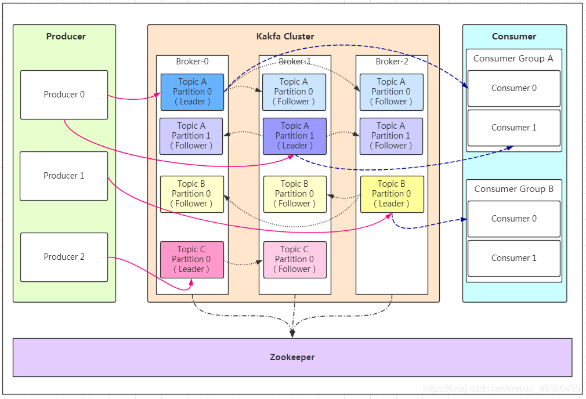
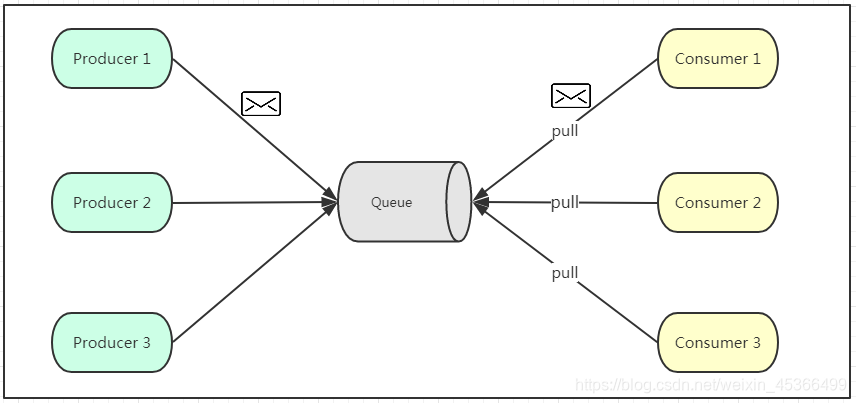
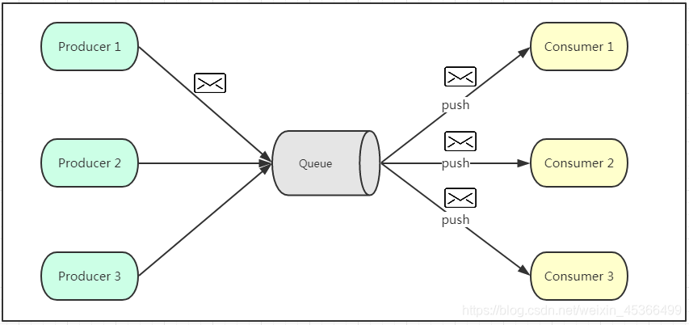
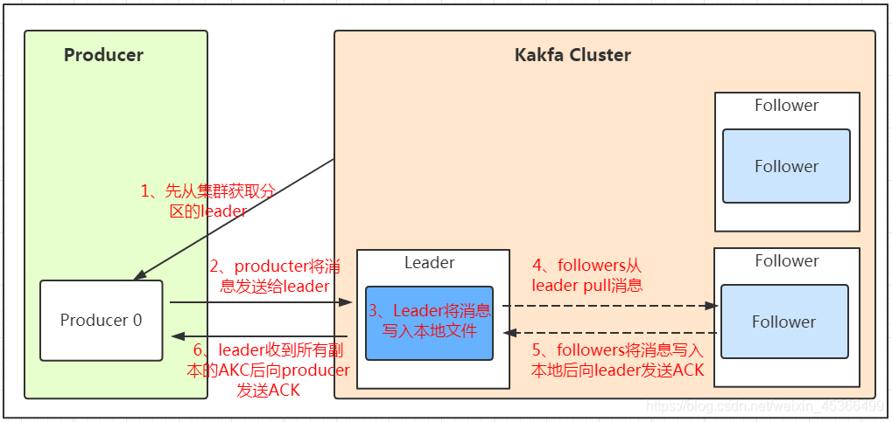
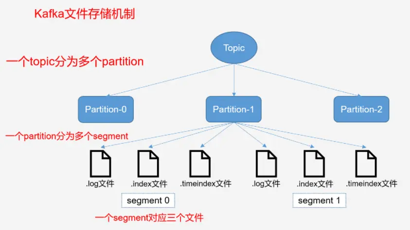
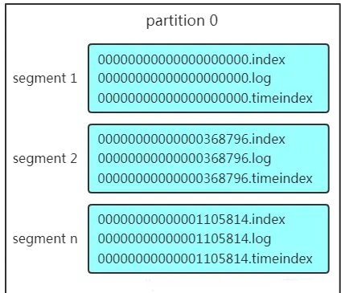

# 参考:
https://segmentfault.com/a/1190000040969234
https://blog.csdn.net/weixin_45366499/article/details/106943229

# kafka的结构

## 核心组件

### 1. Producer（生产者）
- 向Kafka Topic发送消息的客户端应用
- 负责消息的序列化、分区选择和批量发送
- 可以选择发送到特定分区或通过key进行分区路由
- 支持消息压缩和异步发送以提高性能

### 2. Broker（代理服务器）
- Kafka集群由多个Broker组成，每个Broker是一个独立的服务器实例
- 负责处理消息的存储、读写请求和副本管理
- 每个Broker有唯一的ID标识
- 通过ZooKeeper进行协调和管理

### 3. Topic（主题）
- 消息的逻辑分类，类似于消息队列
- 生产者发布消息到特定Topic
- 消费者订阅并从Topic读取消息
- 一个集群可以有多个Topic，每个Topic有独立的配置

### 4. Partition（分区）
- 每个Topic被分为多个Partition
- Partition是消息存储和并行处理的基本单位
- 实现水平扩展，支持多个消费者并行消费不同分区
- 消息在Partition内保持严格有序
- 每个Partition分布在不同的Broker上

### 5. Replica（副本）
- 每个Partition有多个副本用于容错和高可用
- 分为Leader副本和Follower副本
- `Leader负责处理所有读写请求`
- `Follower负责同步Leader的数据，作为备份`

### 6. Consumer（消费者）
- 从Kafka Topic读取消息的客户端应用
- 可以组成Consumer Group实现负载均衡和故障转移
- 支持自动或手动提交offset来跟踪消费进度
- 主动从Broker拉取消息进行处理

### 7. ZooKeeper
- 管理Kafka集群的元数据和配置信息
- 负责Broker的注册发现和Leader选举
- 监控Broker状态和集群拓扑变化
- 存储Topic、Partition和Consumer Group的元数据
# 一条message的格式是怎么样的？

## 1. Kafka消息的逻辑结构

### 消息的基本组成：
```json
{
  "topic": "user-events",           // ✅ 需要在代码中定义：目标主题名称
  "partition": 0,                   // ⚠️ 可选在代码中定义：指定分区（不指定则自动选择）
  "offset": 12345,                  // ❌ 无需定义：由Kafka自动分配
  "timestamp": 1627745932000,       // ⚠️ 可选在代码中定义：消息时间戳（不指定则使用当前时间）
  "key": "user-123",               // ⚠️ 可选在代码中定义：消息键，用于分区路由
  "value": {                       // ✅ 需要在代码中定义：消息体（实际业务数据）
    "userId": "123",
    "action": "login",
    "timestamp": "2023-10-24T10:30:00Z"
  },
  "headers": {                     // ⚠️ 可选在代码中定义：消息头（键值对元数据）
    "contentType": "application/json",
    "correlationId": "abc-123",
    "source": "web-app"
  }
}
```

### 代码中必须定义的字段：
- **topic**：目标主题名称（必需）
- **value**：消息内容（必需）

### 代码中可选定义的字段：
- **key**：消息键，影响分区选择
- **partition**：指定分区编号
- **timestamp**：消息时间戳
- **headers**：消息头信息

### Kafka自动处理的字段：
- **offset**：消息在分区中的唯一标识
- **partition**（如果未指定）：根据key或轮询策略自动选择


## 2. Producer发送消息示例

### Golang Producer代码：

#### 1. 基本消息构造和发送：
```go
// 构造消息内容
userEvent := map[string]interface{}{
    "userId": "123",
    "action": "login",
}
valueBytes, _ := json.Marshal(userEvent)

// 创建消息
message := kafka.Message{
    Key:   []byte("user-123"),           // ✅ 消息key
    Value: valueBytes,                   // ✅ 消息内容
    Headers: []kafka.Header{             // ⚠️ 可选：消息头
        {Key: "contentType", Value: []byte("application/json")},
        {Key: "source", Value: []byte("web-app")},
    },
}

// 发送消息
writer.WriteMessages(context.Background(), message)
```

#### 2. 指定分区发送：
```go
message := kafka.Message{
    Partition: 0,                        // ⚠️ 可选：指定分区
    Key:       []byte("user-456"),
    Value:     []byte(`{"action":"logout"}`),
}

writer.WriteMessages(context.Background(), message)
```

#### 3. 批量消息发送：
```go
messages := []kafka.Message{
    {Key: []byte("user-001"), Value: []byte(`{"action":"login"}`)},
    {Key: []byte("user-002"), Value: []byte(`{"action":"view"}`)},
    {Key: []byte("user-003"), Value: []byte(`{"action":"purchase"}`)},
}

writer.WriteMessages(context.Background(), messages...)
```
# 生产者，kafka集群，消费者三者之间的作用模式

## 1. Kafka的消息通信模式

### 1.1 点对点模式（Point-to-Point）与发布订阅模式（Publish-Subscribe）对比

#### 传统消息队列的两种通信模式：

##### 1. 点对点模式（Queue Model）

```
生产者 → 队列 → 消费者（一对一）
```
- **特点**：每条消息只能被一个消费者消费
- **消费后状态**：消息被消费后从队列中删除
- **应用场景**：任务分发、负载均衡处理
  - **实现方式**：一个Consumer Group内的多个Consumer分别消费不同分区

##### 2. 发布订阅模式（Topic Model）

```
生产者 → 主题 → 多个订阅者（一对多）
```
- **特点**：每条消息可以被多个订阅者消费
- **消费后状态**：消息不会因为被消费而删除
- **应用场景**：事件通知、广播消息
- **实现方式**：多个不同的Consumer Group同时订阅同一个Topic

### 1.2 Kafka如何同时支持两种模式

#### Kafka的统一模型设计：
Kafka通过**Consumer Group**机制巧妙地统一了两种消息模式：

##### 点对点模式实现：
```
Topic: user-tasks
├── Partition 0: [msg1, msg2, msg3]
├── Partition 1: [msg4, msg5, msg6]
└── Partition 2: [msg7, msg8, msg9]

Consumer Group: task-processors
├── Consumer A → Partition 0
├── Consumer B → Partition 1  
└── Consumer C → Partition 2
```
- **实现方式**：一个Consumer Group内的多个Consumer分别消费不同分区
- **效果**：每条消息只被组内一个Consumer处理（点对点）
- **优势**：支持负载均衡和水平扩展


#### 何时使用点对点模式：
- **任务队列**：确保每个任务只被处理一次
- **负载均衡**：将工作分散到多个处理节点
- **顺序处理**：需要严格按顺序处理的业务

#### 何时使用发布订阅模式：
- **事件驱动架构**：同一事件触发多个业务流程
- **数据管道**：同一数据需要多种处理方式
- **微服务解耦**：多个服务需要响应同一事件


## 2. 生产者分区选择策略

### 2.1 生产者发送消息到分区的选择模式

#### 分区选择的三种模式：

##### 1. 指定分区模式（Explicit Partition）
```go
// 直接指定分区编号
message := kafka.Message{
    Partition: 2,                    // 明确指定发送到分区2
    Key:       []byte("user-123"),
    Value:     []byte(`{"action":"login"}`),
}
```
- **适用场景**：需要确保消息发送到特定分区时
- **优势**：完全可控，确定性强
- **劣势**：需要应用层管理分区逻辑，容易造成数据倾斜

##### 2. 不指定分区但设置key（基于Key的哈希分区模式）
```go
// 通过Key进行哈希分区
message := kafka.Message{
    Key:   []byte("user-123"),       // 相同key总是路由到同一分区
    Value: []byte(`{"action":"login"}`),
}
// 分区计算：partition = hash(key) % partition_count
```
- **分区算法**：`partition = hash(key) % partition_count`
- **适用场景**：需要保证相同key的消息有序性（如同一用户的操作）
- **优势**：
  - 相同key的消息保证发送到同一分区，保持局部有序
  - 分区分配相对均匀（如果key分布均匀）
- **劣势**：如果key分布不均，可能导致热分区

##### 3. 不指定分区也不设置key（轮询分区模式）
```go
// 没有指定分区，也没有key
message := kafka.Message{
    Value: []byte(`{"action":"login"}`),  // 只有消息内容
}
// Kafka会轮询选择分区
```
- **分区算法**：按顺序轮流发送到各个分区
- **适用场景**：消息之间没有关联性，只需要负载均衡
- **优势**：
  - 分区分配最均匀
  - 最大化吞吐量
- **劣势**：无法保证消息顺序

### 2.2 自定义分区器（Custom Partitioner）
```go
// 自定义分区逻辑示例
type CustomPartitioner struct{}

func (p *CustomPartitioner) Partition(key []byte, numPartitions int) int {
    if bytes.HasPrefix(key, []byte("vip-")) {
        // VIP用户消息发送到特定分区
        return 0
    } else if bytes.HasPrefix(key, []byte("normal-")) {
        // 普通用户轮询分配
        return int(hash(key)) % (numPartitions - 1) + 1
    }
    return int(hash(key)) % numPartitions
}
```

## 3. 消费者分区消费策略

### 3.1 消费者组内分区分配策略

**前提条件**：消费者组内分区分配策略的前提是：
1. **消费者必须指定要消费的Topic**：每个消费者在加入Consumer Group时需要明确订阅哪些Topic
2. **相同Consumer Group内的所有消费者必须订阅相同的Topic集合**：确保分区分配的一致性
3. **消费者必须指定相同的Group ID**：标识它们属于同一个消费者组

```go
// 消费者组成员都必须订阅相同的Topic并指定相同的Group ID
consumer := kafka.NewReader(kafka.ReaderConfig{
    Brokers:   []string{"localhost:9092"},
    GroupID:   "my-consumer-group",        // ✅ 必须：指定消费者组ID
    Topic:     "user-events",              // ✅ 必须：指定要消费的Topic
    // 其他配置...
})
```

**重要说明**：
- 如果Consumer Group内的消费者订阅了不同的Topic，会导致分区分配失败或不稳定
- 分区分配策略只对Consumer Group内订阅的Topic的分区进行分配
- 不同Consumer Group可以订阅不同的Topic集合，它们之间互不影响

#### 1. Range分配策略（默认）
**消费原理**：Range策略将Topic的所有分区按照分区号排序，然后将连续的分区段分配给消费者。计算方式是：每个消费者分配 `分区总数 ÷ 消费者数量` 个分区，如果有余数，前几个消费者会多分配一个分区。

```
Topic: user-events, 分区: 0,1,2,3,4,5,6,7
Consumer Group: group1, 消费者: C1, C2, C3

分配算法：
8个分区 ÷ 3个消费者 = 2余2
前2个消费者各分配3个分区，最后1个消费者分配2个分区

分配结果：
C1: 分区 0,1,2     (3个分区) - 分区范围 [0, 2]
C2: 分区 3,4,5     (3个分区) - 分区范围 [3, 5]  
C3: 分区 6,7       (2个分区) - 分区范围 [6, 7]
```
- **分配原理**：将分区数除以消费者数，按范围连续分配
- **优势**：实现简单，分配相对均匀
- **劣势**：可能导致分区分配不完全均匀（如上例C3少分配了一个）

#### 2. RoundRobin分配策略
**消费原理**：RoundRobin策略将所有Topic的所有分区统一排序，然后轮询方式逐一分配给消费者。这种方式确保分配更加均匀，特别是在多Topic场景下能避免Range策略可能导致的负载不均。

```
Topic: user-events, 分区: 0,1,2,3,4,5,6,7
Consumer Group: group1, 消费者: C1, C2, C3

分配算法：
将分区按顺序编号：P0, P1, P2, P3, P4, P5, P6, P7
轮询分配：
- P0 → C1, P1 → C2, P2 → C3
- P3 → C1, P4 → C2, P5 → C3  
- P6 → C1, P7 → C2

分配结果：
C1: 分区 0,3,6     (3个分区)
C2: 分区 1,4,7     (3个分区)  
C3: 分区 2,5       (2个分区)
```
- **分配原理**：轮询方式逐个分配分区
- **优势**：在多Topic场景下分配更均匀
- **劣势**：可能破坏分区的局部性

#### 3. Sticky分配策略
**消费原理**：Sticky策略的核心思想是"粘性分配"，即在发生Rebalance时尽可能保持原有的分区分配关系，只对必须重新分配的分区进行调整。这样可以减少分区迁移带来的性能开销，保持消费的连续性和局部性。

```
初始分配（8个分区，3个消费者）：
C1: 分区 0,1,2     (3个分区)
C2: 分区 3,4,5     (3个分区)
C3: 分区 6,7       (2个分区)

Rebalance触发：C2下线
Sticky策略重新分配：
1. C1和C3保持原有分区不变
2. 只重新分配C2的分区3,4,5
3. 尽量均匀分配给剩余消费者

重新分配结果：
C1: 分区 0,1,2,3   (保持原有0,1,2，新增分区3)
C3: 分区 6,7,4,5   (保持原有6,7，新增分区4,5)
```
- **分配原理**：在Rebalance时尽量保持原有分配，减少分区迁移
- **优势**：减少Rebalance时的分区重分配，提高性能
- **劣势**：实现复杂度较高


### 3.2 消费者独立分区指定
**消费原理**：独立分区指定模式下，消费者不加入任何Consumer Group，而是直接指定要消费的Topic和Partition。这种方式完全绕过了Kafka的自动分区分配机制，消费者与分区之间是一对一的固定绑定关系。

```go
// 手动指定消费特定分区（不使用消费者组）
consumer := kafka.NewReader(kafka.ReaderConfig{
    Brokers:   []string{"localhost:9092"},
    Topic:     "user-events",
    Partition: 0,           // 只消费分区0
    MinBytes:  10e3,        // 10KB
    MaxBytes:  10e6,        // 10MB
})
```
- **适用场景**：需要精确控制消费哪个分区
- **优势**：完全自主控制
- **劣势**：失去了消费者组的自动负载均衡和故障转移能力

### 3.3 消费位置策略
**消费原理**：消费位置策略决定了消费者从Topic的哪个位置开始读取消息。这个策略主要影响首次启动或没有已提交offset记录时的消费起始点，对于已有offset记录的Consumer Group，会从上次提交的位置继续消费。

#### 1. 从最新位置开始（Latest）
```go
consumer := kafka.NewReader(kafka.ReaderConfig{
    Brokers:  []string{"localhost:9092"},
    GroupID:  "my-group",
    Topic:    "user-events",
    StartOffset: kafka.LastOffset,  // 从最新消息开始
})
```

#### 2. 从最早位置开始（Earliest）
```go
consumer := kafka.NewReader(kafka.ReaderConfig{
    Brokers:  []string{"localhost:9092"},
    GroupID:  "my-group", 
    Topic:    "user-events",
    StartOffset: kafka.FirstOffset, // 从最早消息开始
})
```

#### 3. 从指定Offset开始
```go
// 先seek到指定位置，再开始消费
consumer.SetOffset(kafka.Message{
    Topic:     "user-events",
    Partition: 0,
    Offset:    12345,  // 指定的offset位置
})
```

## 4. 选择策略的最佳实践

### 生产者策略选择：
- **需要消息顺序**：使用基于Key的分区，确保相同业务实体的消息有序
- **追求最大吞吐**：使用轮询分区，实现负载均衡
- **特殊业务需求**：自定义分区器，实现复杂的分区逻辑

### 消费者策略选择：
- **一般场景**：使用Range策略，简单有效
- **多Topic消费**：使用RoundRobin策略，分配更均匀
- **频繁Rebalance**：使用Sticky策略，减少分区迁移开销
- **精确控制**：手动分配分区，但需要自己处理故障转移

### 关键注意事项：
1. **分区数规划**：分区数应该大于等于最大消费者数
2. **消费者数量**：消费者数不要超过分区数（超出的消费者会空闲）
3. **热分区避免**：合理设计key分布，避免数据倾斜
4. **Rebalance优化**：减少消费者频繁上下线，使用Sticky策略

# 什么是Rebalance？

**Rebalance（重平衡）**是Kafka消费者组中的一个重要机制，当消费者组的成员发生变化时，自动重新分配分区的过程。

##### Rebalance的触发条件：

1. **消费者加入**：新的消费者加入Consumer Group
```
初始状态：C1消费分区0,1,2,3
新消费者C2加入后：
C1消费分区0,1  |  C2消费分区2,3
```

2. **消费者离开**：消费者主动离开或异常下线
```
初始状态：C1消费分区0,1  |  C2消费分区2,3
C2离开后：
C1消费分区0,1,2,3
```

3. **Topic分区数量变化**：管理员增加了Topic的分区数
```
Topic分区从4个增加到6个：
需要重新分配新增的分区5,6给现有消费者
```

4. **消费者会话超时**：消费者心跳超时被认为已失效
```
C2长时间未发送心跳 → 被认为下线 → 触发Rebalance
```

##### Rebalance的执行过程：

```
1. 停止消费 📛
   所有消费者停止拉取消息
   
2. 撤销分区 🔄  
   每个消费者放弃当前分配的分区
   
3. 重新分配 📋
   Group Coordinator根据分配策略重新分配分区
   
4. 恢复消费 ✅
   消费者开始消费新分配的分区
```


**总结**：Rebalance是Kafka的自动化机制，虽然会短暂影响性能，但保证了系统的高可用性和负载均衡。通过合理配置和使用Sticky策略，可以最小化其负面影响。
# kafka发送，保存，消费的完整流程

## 1. 消息生产发送流程

### Producer端：
1. **应用程序创建消息**：包含key、value、timestamp等
2. **序列化**：将消息对象转换为字节数组
3. **分区选择**：
   - 如果指定了partition，直接使用
   - 如果有key，通过hash(key) % partition_num确定分区
   - 如果没有key，采用轮询方式选择分区

### Broker端处理：
1. **接收消息**：Broker接收Producer发送的消息
2. **写入日志**：将消息追加到对应Partition的日志文件末尾
3. **副本主动同步**：Leader将消息同步到Follower副本（follower是主动的去leader进行同步的）
4. **确认应答**：根据acks配置返回确认信息给Producer

## 2 Kafka集群持久化消息流程

### 1. Kafka如何持久化消息

#### 持久化原理：
- **顺序追加写入**：消息按照时间顺序追加到日志文件末尾，这是磁盘顺序I/O，性能很高
- **先写PageCache后刷盘**：消息先写入操作系统的页缓存，然后由OS批量刷写到磁盘
- **多副本机制**：每个分区有多个副本，Leader写入成功后同步到Follower副本确保数据安全

#### 持久化流程：
```
Producer发送消息 → Broker接收 → 分配offset → 追加写入log文件 → 更新索引 → 副本同步 → 确认写入成功
```

### 2. 持久化后的文件存储结构
>在 Kafka 中，一个 Topic 会被分割成多个 Partition, Partition 由多个更小的 Segment 的元素组成。Partition 在服务器上的表现形式就是一个一个的文件夹，每个 partition 文件夹下面会有多组 segment（逻辑分组，并不是真实存在），每个 segment 对应三个文件：`.log文件`、`.index文件`、.`timeindex 文件`



#### 目录结构：
```
kafka-logs/
├── topic-0/                           # 每个分区一个目录
│   ├── 00000000000000000000.log        # 消息数据文件
│   ├── 00000000000000000000.index      # offset索引文件  
│   ├── 00000000000000000000.timeindex  # 时间戳索引文件
│   ├── 00000000000000170410.log        # 新的数据段
│   ├── 00000000000000170410.index      # 对应offset索引文件
│   └── 00000000000000170410.timeindex  # 对应时间戳索引文件
└── topic-1/
```

#### 文件说明：
- **log文件**：存储实际消息内容，按offset顺序存储
- **index文件**：稀疏索引，记录offset在log文件中的物理位置，用于快速查找
- **timeindex文件**：时间戳索引，记录时间戳到offset的映射，支持按时间查找消息
- **文件命名**：`起始offset.扩展名`，如`00000000000000170410.log`表示从offset 170410开始

#### Segment分段机制：
- 每个分区分为多个Segment段，每段包含一个log文件和一个index文件
- 当Segment达到1GB大小或指定时间后，会创建新的Segment
- 只有最新的Segment是活跃的，接收新消息

### 3. 持久化数据的增加和删除

#### 数据增加：
- **追加模式**：新消息总是追加到活跃Segment的末尾
- **自动分段**：当Segment达到大小限制时，自动创建新Segment继续写入
- **索引更新**：每隔4KB写入消息时更新一次索引项，实现快速定位

#### 数据删除：
- **按时间删除**：超过保留时间的旧Segment被整个删除（如保留7天）
- **按大小删除**：当Topic总大小超过限制时，删除最旧的Segment
- **日志压缩**：针对key-value消息，只保留每个key的最新值，删除旧版本
- **删除流程**：标记待删除 → 延迟删除 → 物理删除文件

#### 关键特点：
- **不修改已写入数据**：Kafka是只追加的，已写入的消息不会被修改
- **批量删除**：以Segment为单位删除，不是单条消息删除
- **高效管理**：通过文件系统操作管理数据，简单高效

## 3. 消息消费流程

### Consumer端：
1. **订阅Topic**：Consumer指定要消费的Topic列表
2. **加入Consumer Group**：多个Consumer可以组成一个Consumer Group
3. **分区分配**：Group内的Consumer会被分配不同的Partition
4. **拉取消息**：Consumer主动从Broker拉取消息
5. **反序列化**：将字节数组转换回消息对象
6. **业务处理**：应用程序处理消息内容
7. **提交Offset**：记录消费进度，支持自动或手动提交

### 详细消费过程：
1. **发送FetchRequest**：Consumer向Broker发送拉取请求
2. **Broker响应**：返回从指定offset开始的消息batch
3. **本地缓存**：Consumer将消息缓存在本地队列
4. **按序消费**：从队列中取出消息进行处理
5. **Offset管理**：更新消费位置，防止重复消费

## 3. 关键机制

### Offset管理：
- 每个Consumer Group在每个Partition上都有独立的offset
- Offset存储在特殊的Topic `__consumer_offsets` 中
- 支持从最早、最新或指定位置开始消费

### 消费者组协调：
- 通过Group Coordinator协调Consumer Group
- 当Consumer加入/离开时触发Rebalance
- 确保每个Partition只被组内一个Consumer消费

### 容错机制：
- Consumer失效时，其分区会重新分配给其他Consumer
- 支持消息重复消费和幂等处理
- 通过事务机制保证Exactly-Once语义


# kafka相比其它系统的特点以及优势(为什么选择kafka)

## 相比传统消息队列的优势

### 1. 高吞吐量
- **顺序写入**：Kafka采用顺序写磁盘，避免随机I/O
- **批量处理**：支持消息批量发送和接收
- **零拷贝技术**：使用sendfile()系统调用，减少数据拷贝
- **性能数据**：单机可达百万级TPS

### 2. 持久化存储
- **消息持久化**：所有消息都写入磁盘，不会因为内存不足丢失
- **可配置保留期**：支持按时间或大小清理旧消息
- **多副本机制**：确保数据不丢失
- **对比**：传统MQ主要基于内存，容易丢失消息

### 3. 分布式架构
- **水平扩展**：通过增加Broker和Partition实现扩容
- **负载均衡**：消息和消费负载分布在多个节点
- **容错能力**：单节点故障不影响整体服务
- **对比**：传统MQ往往是单点或主备模式

## Kafka 场景应用

### 日志收集
- 场景：集中采集各类服务与应用的日志（应用日志、访问日志、审计日志等）。
- 实现要点：各服务将日志以消息发送到统一 Topic，消费端（Elasticsearch/Logstash/Kibana、Hadoop、HBase 等）订阅并处理。
- 优势：高吞吐、可持久化、解耦生产者与消费端、便于回放和离线分析。

### 消息系统（异步通信 / 解耦）
- 场景：微服务间异步通信、任务队列、请求缓冲。
- 实现要点：按业务划分 Topic，使用 Consumer Group 做负载均衡；根据需求配置 acks、重试与幂等/事务保证。
- 优势：松耦合、弹性伸缩、抗峰值能力强。

### 用户行为/活动跟踪
- 场景：记录网页或移动端的点击、浏览、搜索、会话等行为事件。
- 实现要点：前端或网关将事件写入 Kafka，实时流式处理（如实时计数、会话拼接），并落盘到数据仓库用于离线分析。
- 优势：低延迟、高并发，支持实时监控与离线挖掘。

### 运营指标与监控
- 场景：收集各类指标（性能、错误率、业务 KPI）、告警事件、审计数据。
- 实现要点：指标打点通过 Kafka 汇总，再由流处理或消费程序聚合、触发告警或写入时序数据库。
- 优势：统一入口、便于横向扩展、支持多路消费（实时与离线同时使用）。

### 流式处理（实时计算）
- 场景：实时 ETL、聚合、窗口计算、复杂事件处理。
- 常用框架：Kafka Streams、Flink、Spark Streaming、Storm。
- 优势：与消息总线紧密集成，低延迟、端到端可组合的流处理能力。

### 事件溯源（Event Sourcing）与数据重放
- 场景：将业务事件作为事实存储，系统状态由事件序列重建；支持故障恢复与数据回放。
- 实现要点：使用持久化 Topic（保留期/压缩策略），按事件时间或 offset 回放消费。
- 优势：不可变事件账本、支持审计与历史回溯。

### 实践建议（注意事项）
- Topic 与 Partition 设计要基于吞吐与并发需求，避免热分区。
- 保留策略：根据场景选择时长保留或压缩（log compaction）策略。
- 模式管理：使用 Schema Registry（Avro/Protobuf/JSON Schema）保证数据演进兼容。
- 监控与容量规划：监控 lag、吞吐、磁盘使用与副本健康，规划 Broker/Partition 扩容方案。

（根据具体业务可组合以上场景，Kafka 常作为实时与离线管道的核心组件。）

