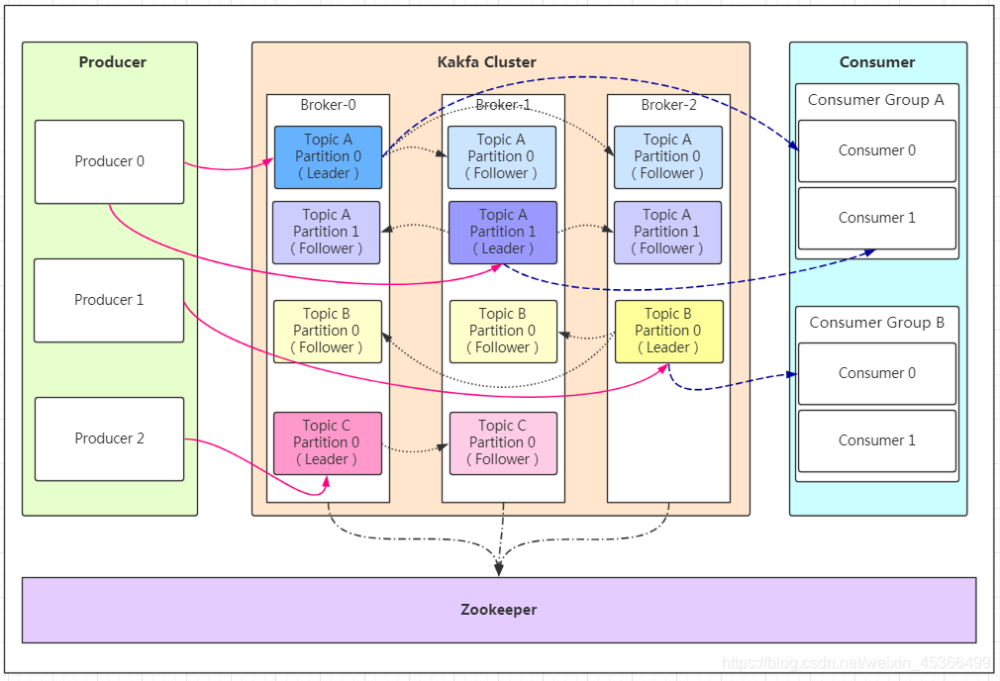
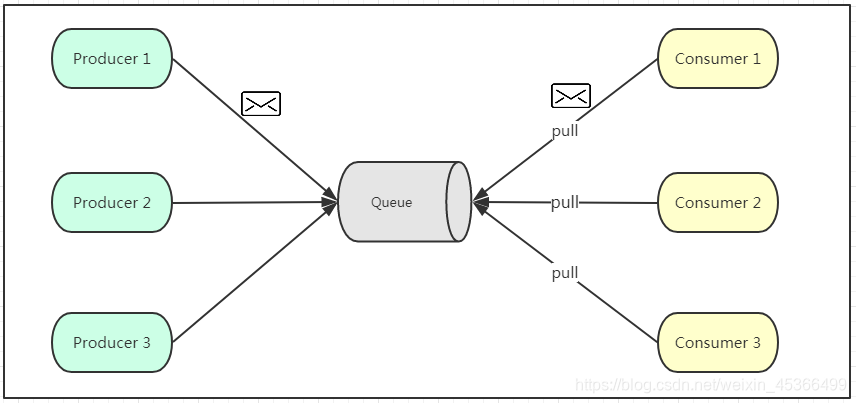
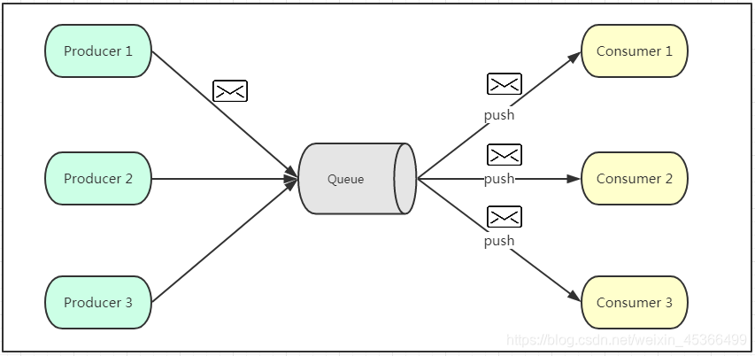
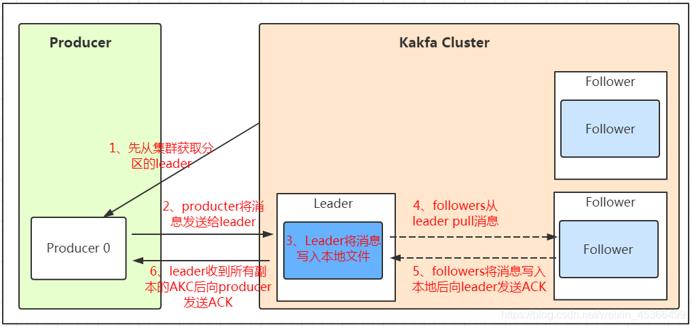
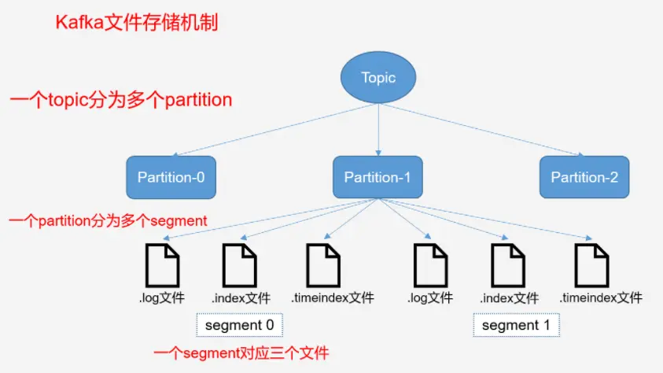
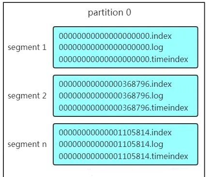

# 参考:
https://segmentfault.com/a/1190000040969234
https://blog.csdn.net/weixin_45366499/article/details/106943229

# kafka的结构

## 核心组件

### 1. Producer（生产者）
- 向Kafka Topic发送消息的客户端应用
- 负责消息的序列化、分区选择和批量发送
- 可以选择发送到特定分区或通过key进行分区路由
- 支持消息压缩和异步发送以提高性能

### 2. Broker（代理服务器）
- Kafka集群由多个Broker组成，每个Broker是一个独立的服务器实例
- 负责处理消息的存储、读写请求和副本管理
- 每个Broker有唯一的ID标识
- 通过ZooKeeper进行协调和管理

### 3. Topic（主题）
- 消息的逻辑分类，类似于消息队列
- 生产者发布消息到特定Topic
- 消费者订阅并从Topic读取消息
- 一个集群可以有多个Topic，每个Topic有独立的配置

### 4. Partition（分区）
- 每个Topic被分为多个Partition
- Partition是消息存储和并行处理的基本单位
- 实现水平扩展，支持多个消费者并行消费不同分区
- 消息在Partition内保持严格有序
- 每个Partition分布在不同的Broker上

### 5. Replica（副本）
- 每个Partition有多个副本用于容错和高可用
- 分为Leader副本和Follower副本
- `Leader负责处理所有读写请求`
- `Follower负责同步Leader的数据，作为备份`

### 6. Consumer（消费者）
- 从Kafka Topic读取消息的客户端应用
- 可以组成Consumer Group实现负载均衡和故障转移
- 支持自动或手动提交offset来跟踪消费进度
- 主动从Broker拉取消息进行处理

### 7. ZooKeeper
- 管理Kafka集群的元数据和配置信息
- 负责Broker的注册发现和Leader选举
- 监控Broker状态和集群拓扑变化
- 存储Topic、Partition和Consumer Group的元数据
# 一条message的格式是怎么样的？

## 1. Kafka消息的逻辑结构

### 消息的基本组成：
```json
{
  "topic": "user-events",           // ✅ 需要在代码中定义：目标主题名称
  "partition": 0,                   // ⚠️ 可选在代码中定义：指定分区（不指定则自动选择）
  "offset": 12345,                  // ❌ 无需定义：由Kafka自动分配
  "timestamp": 1627745932000,       // ⚠️ 可选在代码中定义：消息时间戳（不指定则使用当前时间）
  "key": "user-123",               // ⚠️ 可选在代码中定义：消息键，用于分区路由
  "value": {                       // ✅ 需要在代码中定义：消息体（实际业务数据）
    "userId": "123",
    "action": "login",
    "timestamp": "2023-10-24T10:30:00Z"
  },
  "headers": {                     // ⚠️ 可选在代码中定义：消息头（键值对元数据）
    "contentType": "application/json",
    "correlationId": "abc-123",
    "source": "web-app"
  }
}
```

### 代码中必须定义的字段：
- **topic**：目标主题名称（必需）
- **value**：消息内容（必需）

### 代码中可选定义的字段：
- **key**：消息键，影响分区选择
- **partition**：指定分区编号
- **timestamp**：消息时间戳
- **headers**：消息头信息

### Kafka自动处理的字段：
- **offset**：消息在分区中的唯一标识
- **partition**（如果未指定）：根据key或轮询策略自动选择


## 2. Producer发送消息示例

### Golang Producer代码：

#### 1. 基本消息构造和发送：
```go
// 构造消息内容
userEvent := map[string]interface{}{
    "userId": "123",
    "action": "login",
}
valueBytes, _ := json.Marshal(userEvent)

// 创建消息
message := kafka.Message{
    Key:   []byte("user-123"),           // ✅ 消息key
    Value: valueBytes,                   // ✅ 消息内容
    Headers: []kafka.Header{             // ⚠️ 可选：消息头
        {Key: "contentType", Value: []byte("application/json")},
        {Key: "source", Value: []byte("web-app")},
    },
}

// 发送消息
writer.WriteMessages(context.Background(), message)
```

#### 2. 指定分区发送：
```go
message := kafka.Message{
    Partition: 0,                        // ⚠️ 可选：指定分区
    Key:       []byte("user-456"),
    Value:     []byte(`{"action":"logout"}`),
}

writer.WriteMessages(context.Background(), message)
```

#### 3. 批量消息发送：
```go
messages := []kafka.Message{
    {Key: []byte("user-001"), Value: []byte(`{"action":"login"}`)},
    {Key: []byte("user-002"), Value: []byte(`{"action":"view"}`)},
    {Key: []byte("user-003"), Value: []byte(`{"action":"purchase"}`)},
}

writer.WriteMessages(context.Background(), messages...)
```
# 生产者，kafka集群，消费者三者之间的作用模式

## 1. Kafka的消息通信模式

### 1.1 点对点模式（Point-to-Point）与发布订阅模式（Publish-Subscribe）对比

#### 传统消息队列的两种通信模式：

##### 1. 点对点模式（Queue Model）

```
生产者 → 队列 → 消费者（一对一）
```
- **特点**：每条消息只能被一个消费者消费
- **消费后状态**：消息被消费后从队列中删除
- **应用场景**：任务分发、负载均衡处理
  - **实现方式**：一个Consumer Group内的多个Consumer分别消费不同分区

##### 2. 发布订阅模式（Topic Model）

```
生产者 → 主题 → 多个订阅者（一对多）
```
- **特点**：每条消息可以被多个订阅者消费
- **消费后状态**：消息不会因为被消费而删除
- **应用场景**：事件通知、广播消息
- **实现方式**：多个不同的Consumer Group同时订阅同一个Topic

### 1.2 Kafka如何同时支持两种模式

#### Kafka的统一模型设计：
Kafka通过**Consumer Group**机制巧妙地统一了两种消息模式：

##### 点对点模式实现：
```
Topic: user-tasks
├── Partition 0: [msg1, msg2, msg3]
├── Partition 1: [msg4, msg5, msg6]
└── Partition 2: [msg7, msg8, msg9]

Consumer Group: task-processors
├── Consumer A → Partition 0
├── Consumer B → Partition 1  
└── Consumer C → Partition 2
```
- **实现方式**：一个Consumer Group内的多个Consumer分别消费不同分区
- **效果**：每条消息只被组内一个Consumer处理（点对点）
- **优势**：支持负载均衡和水平扩展


#### 何时使用点对点模式：
- **任务队列**：确保每个任务只被处理一次
- **负载均衡**：将工作分散到多个处理节点
- **顺序处理**：需要严格按顺序处理的业务

#### 何时使用发布订阅模式：
- **事件驱动架构**：同一事件触发多个业务流程
- **数据管道**：同一数据需要多种处理方式
- **微服务解耦**：多个服务需要响应同一事件


## 2. 生产者分区选择策略

### 2.1 生产者发送消息到分区的选择模式

#### 分区选择的三种模式：

##### 1. 指定分区模式（Explicit Partition）
```go
// 直接指定分区编号
message := kafka.Message{
    Partition: 2,                    // 明确指定发送到分区2
    Key:       []byte("user-123"),
    Value:     []byte(`{"action":"login"}`),
}
```
- **适用场景**：需要确保消息发送到特定分区时
- **优势**：完全可控，确定性强
- **劣势**：需要应用层管理分区逻辑，容易造成数据倾斜

##### 2. 不指定分区但设置key（基于Key的哈希分区模式）
```go
// 通过Key进行哈希分区
message := kafka.Message{
    Key:   []byte("user-123"),       // 相同key总是路由到同一分区
    Value: []byte(`{"action":"login"}`),
}
// 分区计算：partition = hash(key) % partition_count
```
- **分区算法**：`partition = hash(key) % partition_count`
- **适用场景**：需要保证相同key的消息有序性（如同一用户的操作）
- **优势**：
  - 相同key的消息保证发送到同一分区，保持局部有序
  - 分区分配相对均匀（如果key分布均匀）
- **劣势**：如果key分布不均，可能导致热分区

##### 3. 不指定分区也不设置key（轮询分区模式）
```go
// 没有指定分区，也没有key
message := kafka.Message{
    Value: []byte(`{"action":"login"}`),  // 只有消息内容
}
// Kafka会轮询选择分区
```
- **分区算法**：按顺序轮流发送到各个分区
- **适用场景**：消息之间没有关联性，只需要负载均衡
- **优势**：
  - 分区分配最均匀
  - 最大化吞吐量
- **劣势**：无法保证消息顺序

### 2.2 自定义分区器（Custom Partitioner）
```go
// 自定义分区逻辑示例
type CustomPartitioner struct{}

func (p *CustomPartitioner) Partition(key []byte, numPartitions int) int {
    if bytes.HasPrefix(key, []byte("vip-")) {
        // VIP用户消息发送到特定分区
        return 0
    } else if bytes.HasPrefix(key, []byte("normal-")) {
        // 普通用户轮询分配
        return int(hash(key)) % (numPartitions - 1) + 1
    }
    return int(hash(key)) % numPartitions
}
```

## 3. 消费者分区消费策略

### 3.1 消费者组内分区分配策略

**前提条件**：消费者组内分区分配策略的前提是：
1. **消费者必须指定要消费的Topic**：每个消费者在加入Consumer Group时需要明确订阅哪些Topic
2. **相同Consumer Group内的所有消费者必须订阅相同的Topic集合**：确保分区分配的一致性
3. **消费者必须指定相同的Group ID**：标识它们属于同一个消费者组

```go
// 消费者组成员都必须订阅相同的Topic并指定相同的Group ID
consumer := kafka.NewReader(kafka.ReaderConfig{
    Brokers:   []string{"localhost:9092"},
    GroupID:   "my-consumer-group",        // ✅ 必须：指定消费者组ID
    Topic:     "user-events",              // ✅ 必须：指定要消费的Topic
    // 其他配置...
})
```

**重要说明**：
- 如果Consumer Group内的消费者订阅了不同的Topic，会导致分区分配失败或不稳定
- 分区分配策略只对Consumer Group内订阅的Topic的分区进行分配
- 不同Consumer Group可以订阅不同的Topic集合，它们之间互不影响

#### 1. Range分配策略（默认）
**消费原理**：Range策略将Topic的所有分区按照分区号排序，然后将连续的分区段分配给消费者。计算方式是：每个消费者分配 `分区总数 ÷ 消费者数量` 个分区，如果有余数，前几个消费者会多分配一个分区。

```
Topic: user-events, 分区: 0,1,2,3,4,5,6,7
Consumer Group: group1, 消费者: C1, C2, C3

分配算法：
8个分区 ÷ 3个消费者 = 2余2
前2个消费者各分配3个分区，最后1个消费者分配2个分区

分配结果：
C1: 分区 0,1,2     (3个分区) - 分区范围 [0, 2]
C2: 分区 3,4,5     (3个分区) - 分区范围 [3, 5]  
C3: 分区 6,7       (2个分区) - 分区范围 [6, 7]
```
- **分配原理**：将分区数除以消费者数，按范围连续分配
- **优势**：实现简单，分配相对均匀
- **劣势**：可能导致分区分配不完全均匀（如上例C3少分配了一个）

#### 2. RoundRobin分配策略
**消费原理**：RoundRobin策略将所有Topic的所有分区统一排序，然后轮询方式逐一分配给消费者。这种方式确保分配更加均匀，特别是在多Topic场景下能避免Range策略可能导致的负载不均。

```
Topic: user-events, 分区: 0,1,2,3,4,5,6,7
Consumer Group: group1, 消费者: C1, C2, C3

分配算法：
将分区按顺序编号：P0, P1, P2, P3, P4, P5, P6, P7
轮询分配：
- P0 → C1, P1 → C2, P2 → C3
- P3 → C1, P4 → C2, P5 → C3  
- P6 → C1, P7 → C2

分配结果：
C1: 分区 0,3,6     (3个分区)
C2: 分区 1,4,7     (3个分区)  
C3: 分区 2,5       (2个分区)
```
- **分配原理**：轮询方式逐个分配分区
- **优势**：在多Topic场景下分配更均匀
- **劣势**：可能破坏分区的局部性

#### 3. Sticky分配策略
**消费原理**：Sticky策略的核心思想是"粘性分配"，即在发生Rebalance时尽可能保持原有的分区分配关系，只对必须重新分配的分区进行调整。这样可以减少分区迁移带来的性能开销，保持消费的连续性和局部性。

```
初始分配（8个分区，3个消费者）：
C1: 分区 0,1,2     (3个分区)
C2: 分区 3,4,5     (3个分区)
C3: 分区 6,7       (2个分区)

Rebalance触发：C2下线
Sticky策略重新分配：
1. C1和C3保持原有分区不变
2. 只重新分配C2的分区3,4,5
3. 尽量均匀分配给剩余消费者

重新分配结果：
C1: 分区 0,1,2,3   (保持原有0,1,2，新增分区3)
C3: 分区 6,7,4,5   (保持原有6,7，新增分区4,5)
```
- **分配原理**：在Rebalance时尽量保持原有分配，减少分区迁移
- **优势**：减少Rebalance时的分区重分配，提高性能
- **劣势**：实现复杂度较高


### 3.2 消费者独立分区指定
**消费原理**：独立分区指定模式下，消费者不加入任何Consumer Group，而是直接指定要消费的Topic和Partition。这种方式完全绕过了Kafka的自动分区分配机制，消费者与分区之间是一对一的固定绑定关系。

```go
// 手动指定消费特定分区（不使用消费者组）
consumer := kafka.NewReader(kafka.ReaderConfig{
    Brokers:   []string{"localhost:9092"},
    Topic:     "user-events",
    Partition: 0,           // 只消费分区0
    MinBytes:  10e3,        // 10KB
    MaxBytes:  10e6,        // 10MB
})
```
- **适用场景**：需要精确控制消费哪个分区
- **优势**：完全自主控制
- **劣势**：失去了消费者组的自动负载均衡和故障转移能力

### 3.3 消费位置策略
**消费原理**：消费位置策略决定了消费者从Topic的哪个位置开始读取消息。这个策略主要影响首次启动或没有已提交offset记录时的消费起始点，对于已有offset记录的Consumer Group，会从上次提交的位置继续消费。

#### 1. 从最新位置开始（Latest）
```go
consumer := kafka.NewReader(kafka.ReaderConfig{
    Brokers:  []string{"localhost:9092"},
    GroupID:  "my-group",
    Topic:    "user-events",
    StartOffset: kafka.LastOffset,  // 从最新消息开始
})
```

#### 2. 从最早位置开始（Earliest）
```go
consumer := kafka.NewReader(kafka.ReaderConfig{
    Brokers:  []string{"localhost:9092"},
    GroupID:  "my-group", 
    Topic:    "user-events",
    StartOffset: kafka.FirstOffset, // 从最早消息开始
})
```

#### 3. 从指定Offset开始
```go
// 先seek到指定位置，再开始消费
consumer.SetOffset(kafka.Message{
    Topic:     "user-events",
    Partition: 0,
    Offset:    12345,  // 指定的offset位置
})
```

## 4. 选择策略的最佳实践

### 生产者策略选择：
- **需要消息顺序**：使用基于Key的分区，确保相同业务实体的消息有序
- **追求最大吞吐**：使用轮询分区，实现负载均衡
- **特殊业务需求**：自定义分区器，实现复杂的分区逻辑

### 消费者策略选择：
- **一般场景**：使用Range策略，简单有效
- **多Topic消费**：使用RoundRobin策略，分配更均匀
- **频繁Rebalance**：使用Sticky策略，减少分区迁移开销
- **精确控制**：手动分配分区，但需要自己处理故障转移

### 关键注意事项：
1. **分区数规划**：分区数应该大于等于最大消费者数
2. **消费者数量**：消费者数不要超过分区数（超出的消费者会空闲）
3. **热分区避免**：合理设计key分布，避免数据倾斜
4. **Rebalance优化**：减少消费者频繁上下线，使用Sticky策略

# 什么是Rebalance？

**Rebalance（重平衡）**是Kafka消费者组中的一个重要机制，当消费者组的成员发生变化时，自动重新分配分区的过程。

##### Rebalance的触发条件：

1. **消费者加入**：新的消费者加入Consumer Group
```
初始状态：C1消费分区0,1,2,3
新消费者C2加入后：
C1消费分区0,1  |  C2消费分区2,3
```

2. **消费者离开**：消费者主动离开或异常下线
```
初始状态：C1消费分区0,1  |  C2消费分区2,3
C2离开后：
C1消费分区0,1,2,3
```

3. **Topic分区数量变化**：管理员增加了Topic的分区数
```
Topic分区从4个增加到6个：
需要重新分配新增的分区5,6给现有消费者
```

4. **消费者会话超时**：消费者心跳超时被认为已失效
```
C2长时间未发送心跳 → 被认为下线 → 触发Rebalance
```

##### Rebalance的执行过程：

```
1. 停止消费 📛
   所有消费者停止拉取消息
   
2. 撤销分区 🔄  
   每个消费者放弃当前分配的分区
   
3. 重新分配 📋
   Group Coordinator根据分配策略重新分配分区
   
4. 恢复消费 ✅
   消费者开始消费新分配的分区
```


**总结**：Rebalance是Kafka的自动化机制，虽然会短暂影响性能，但保证了系统的高可用性和负载均衡。通过合理配置和使用Sticky策略，可以最小化其负面影响。
# kafka发送，保存，消费的完整流程

## 1. 消息生产发送流程

### Producer端：
1. **应用程序创建消息**：包含key、value、timestamp等
2. **序列化**：将消息对象转换为字节数组
3. **分区选择**：
   - 如果指定了partition，直接使用
   - 如果有key，通过hash(key) % partition_num确定分区
   - 如果没有key，采用轮询方式选择分区

### Broker端处理：
1. **接收消息**：Broker接收Producer发送的消息
2. **写入日志**：将消息追加到对应Partition的日志文件末尾
3. **副本主动同步**：Leader将消息同步到Follower副本（follower是主动的去leader进行同步的）
4. **确认应答**：根据acks配置返回确认信息给Producer

## 2 Kafka集群持久化消息流程

### 1. Kafka如何持久化消息

#### 持久化原理：
- **顺序追加写入**：消息按照时间顺序追加到日志文件末尾，这是磁盘顺序I/O，性能很高
- **先写PageCache后刷盘**：消息先写入操作系统的页缓存，然后由OS批量刷写到磁盘
- **多副本机制**：每个分区有多个副本，Leader写入成功后同步到Follower副本确保数据安全

#### 持久化流程：
```
Producer发送消息 → Broker接收 → 分配offset → 追加写入log文件 → 更新索引 → 副本同步 → 确认写入成功
```

### 2. 持久化后的文件存储结构
>在 Kafka 中，一个 Topic 会被分割成多个 Partition, Partition 由多个更小的 Segment 的元素组成。Partition 在服务器上的表现形式就是一个一个的文件夹，每个 partition 文件夹下面会有多组 segment（逻辑分组，并不是真实存在），每个 segment 对应三个文件：`.log文件`、`.index文件`、.`timeindex 文件`



#### 目录结构：
```
kafka-logs/
├── topic-0/                           # 每个分区一个目录
│   ├── 00000000000000000000.log        # 消息数据文件
│   ├── 00000000000000000000.index      # offset索引文件  
│   ├── 00000000000000000000.timeindex  # 时间戳索引文件
│   ├── 00000000000000170410.log        # 新的数据段
│   ├── 00000000000000170410.index      # 对应offset索引文件
│   └── 00000000000000170410.timeindex  # 对应时间戳索引文件
└── topic-1/
```

#### 文件说明：
- **log文件**：存储实际消息内容，按offset顺序存储
- **index文件**：稀疏索引，记录offset在log文件中的物理位置，用于快速查找
- **timeindex文件**：时间戳索引，记录时间戳到offset的映射，支持按时间查找消息
- **文件命名**：`起始offset.扩展名`，如`00000000000000170410.log`表示从offset 170410开始

#### Segment分段机制：
- 每个分区分为多个Segment段，每段包含一个log文件和一个index文件
- 当Segment达到1GB大小或指定时间后，会创建新的Segment
- 只有最新的Segment是活跃的，接收新消息

### 3. 持久化数据的增加和删除

#### 数据增加：
- **追加模式**：新消息总是追加到活跃Segment的末尾
- **自动分段**：当Segment达到大小限制时，自动创建新Segment继续写入
- **索引更新**：每隔4KB写入消息时更新一次索引项，实现快速定位

#### 数据删除：
- **按时间删除**：超过保留时间的旧Segment被整个删除（如保留7天）
- **按大小删除**：当Topic总大小超过限制时，删除最旧的Segment
- **日志压缩**：针对key-value消息，只保留每个key的最新值，删除旧版本
- **删除流程**：标记待删除 → 延迟删除 → 物理删除文件

#### 关键特点：
- **不修改已写入数据**：Kafka是只追加的，已写入的消息不会被修改
- **批量删除**：以Segment为单位删除，不是单条消息删除
- **高效管理**：通过文件系统操作管理数据，简单高效

## 3. 消息消费流程

### Consumer端：
1. **订阅Topic**：Consumer指定要消费的Topic列表
2. **加入Consumer Group**：多个Consumer可以组成一个Consumer Group
3. **分区分配**：Group内的Consumer会被分配不同的Partition
4. **拉取消息**：Consumer主动从Broker拉取消息
5. **反序列化**：将字节数组转换回消息对象
6. **业务处理**：应用程序处理消息内容
7. **提交Offset**：记录消费进度，支持自动或手动提交

### 详细消费过程：
1. **发送FetchRequest**：Consumer向Broker发送拉取请求
2. **Broker响应**：返回从指定offset开始的消息batch
3. **本地缓存**：Consumer将消息缓存在本地队列
4. **按序消费**：从队列中取出消息进行处理
5. **Offset管理**：更新消费位置，防止重复消费

## 3. 关键机制

### Offset管理：
- 每个Consumer Group在每个Partition上都有独立的offset
- Offset存储在特殊的Topic `__consumer_offsets` 中
- 支持从最早、最新或指定位置开始消费

### 消费者组协调：
- 通过Group Coordinator协调Consumer Group
- 当Consumer加入/离开时触发Rebalance
- 确保每个Partition只被组内一个Consumer消费

### 容错机制：
- Consumer失效时，其分区会重新分配给其他Consumer
- 支持消息重复消费和幂等处理
- 通过事务机制保证Exactly-Once语义

### 分区与消费者关系 & 重复消费语义

#### 1. 多个消费者能否同时消费同一个分区？
- **同一Consumer Group内**：同一时刻，一个分区只会被分配给组内**一个消费者实例**，以保证分区内消息顺序和组内负载均衡。
- **不同Consumer Group之间**：同一个分区可以同时被多个不同的Consumer Group 各自消费，每个Group维护自己的offset，互不影响。

#### 2. 同一个分区的消息会不会被重复消费？
- 会，Kafka的默认语义通常是**至少一次（at-least-once）**：
  - 常见模式是：`消费并处理消息 → 提交offset`。
  - 如果处理完成后还没来得及提交offset就故障/重启，下次恢复会从旧offset重新拉取，导致这段消息被再次消费。
- 手动调整offset（例如回溯历史数据）时，也会出现重复消费，这是正常且允许的行为。

#### 3. 重复消费如何处理？
- **Kafka本身不做业务级去重**，只提供offset管理和投递语义，避免消息丢失，但允许重复。
- 典型处理方式是在业务侧实现**幂等/去重**：
  - 为每条消息设计唯一业务ID（如订单号、事件ID等）。
  - 下游写数据库时通过唯一约束、upsert、先查后写等方式保证重复处理不产生副作用。
- 更高要求场景可结合**幂等生产者 + 事务**等能力，构建端到端接近**精确一次（exactly-once）**的效果。

# kafka相比其它系统的特点以及优势(为什么选择kafka)

## 相比传统消息队列的优势

### 1. 高吞吐量
- **顺序写入**：Kafka采用顺序写磁盘，避免随机I/O
- **批量处理**：支持消息批量发送和接收
- **零拷贝技术**：使用sendfile()系统调用，减少数据拷贝
- **性能数据**：单机可达百万级TPS

### 2. 持久化存储
- **消息持久化**：所有消息都写入磁盘，不会因为内存不足丢失
- **可配置保留期**：支持按时间或大小清理旧消息
- **多副本机制**：确保数据不丢失
- **对比**：传统MQ主要基于内存，容易丢失消息

### 3. 分布式架构
- **水平扩展**：通过增加Broker和Partition实现扩容
- **负载均衡**：消息和消费负载分布在多个节点
- **容错能力**：单节点故障不影响整体服务
- **对比**：传统MQ往往是单点或主备模式

## Kafka 场景应用

### 日志收集
- 场景：集中采集各类服务与应用的日志（应用日志、访问日志、审计日志等）。
- 实现要点：各服务将日志以消息发送到统一 Topic，消费端（Elasticsearch/Logstash/Kibana、Hadoop、HBase 等）订阅并处理。
- 优势：高吞吐、可持久化、解耦生产者与消费端、便于回放和离线分析。

### 消息系统（异步通信 / 解耦）
- 场景：微服务间异步通信、任务队列、请求缓冲。
- 实现要点：按业务划分 Topic，使用 Consumer Group 做负载均衡；根据需求配置 acks、重试与幂等/事务保证。
- 优势：松耦合、弹性伸缩、抗峰值能力强。

### 用户行为/活动跟踪
- 场景：记录网页或移动端的点击、浏览、搜索、会话等行为事件。
- 实现要点：前端或网关将事件写入 Kafka，实时流式处理（如实时计数、会话拼接），并落盘到数据仓库用于离线分析。
- 优势：低延迟、高并发，支持实时监控与离线挖掘。

### 运营指标与监控
- 场景：收集各类指标（性能、错误率、业务 KPI）、告警事件、审计数据。
- 实现要点：指标打点通过 Kafka 汇总，再由流处理或消费程序聚合、触发告警或写入时序数据库。
- 优势：统一入口、便于横向扩展、支持多路消费（实时与离线同时使用）。

### 流式处理（实时计算）
- 场景：实时 ETL、聚合、窗口计算、复杂事件处理。
- 常用框架：Kafka Streams、Flink、Spark Streaming、Storm。
- 优势：与消息总线紧密集成，低延迟、端到端可组合的流处理能力。

### 事件溯源（Event Sourcing）与数据重放
- 场景：将业务事件作为事实存储，系统状态由事件序列重建；支持故障恢复与数据回放。
- 实现要点：使用持久化 Topic（保留期/压缩策略），按事件时间或 offset 回放消费。
- 优势：不可变事件账本、支持审计与历史回溯。

### 实践建议（注意事项）
- Topic 与 Partition 设计要基于吞吐与并发需求，避免热分区。
- 保留策略：根据场景选择时长保留或压缩（log compaction）策略。
- 模式管理：使用 Schema Registry（Avro/Protobuf/JSON Schema）保证数据演进兼容。
- 监控与容量规划：监控 lag、吞吐、磁盘使用与副本健康，规划 Broker/Partition 扩容方案。

（根据具体业务可组合以上场景，Kafka 常作为实时与离线管道的核心组件。）

# 消息传递失败的问题处理方案

在Kafka的消息传递过程中，可能在生产者发送阶段或消费者消费阶段出现失败。本章节详细分析这两个阶段的失败场景及其解决方案。
## 前提知识：消息确认机制

### 1. 生产者如何知道消息被成功接收？

**ACK确认机制**：
生产者通过配置`acks`参数来控制消息确认级别：

```properties
# 三种确认级别
acks=0    # 不等待确认（最快，可能丢失）
acks=1    # 等待Leader确认（平衡性能和可靠性）
acks=all  # 等待所有副本确认（最安全，性能较低）
```

**确认流程**：
```
生产者发送消息 → Broker接收并存储 → 根据acks配置等待副本同步 → 
返回确认响应 → 生产者收到成功/失败通知
```

**详细过程**：
- **acks=0**：Producer发送后立即认为成功，不等待任何确认
- **acks=1**：等待Leader分区写入成功，Follower可能还未同步
- **acks=all**：等待ISR（In-Sync Replicas）中所有副本都确认写入成功

**异步确认处理**：
```go
// 异步发送并处理确认
future := producer.Send(message)
future.OnComplete(func(metadata RecordMetadata, err error) {
    if err != nil {
        // 发送失败，触发重试或错误处理
        log.Error("消息发送失败", err)
    } else {
        // 发送成功，记录offset和分区信息
        log.Info("消息发送成功", metadata.Offset, metadata.Partition)
    }
})
```

### 2. Kafka如何知道消息被成功消费？

**Offset提交机制**：
消费者通过提交Offset来告知Kafka消息已被处理：

```properties
# 两种提交方式
enable.auto.commit=true   # 自动提交（定期提交）
enable.auto.commit=false  # 手动提交（精确控制）
```

**提交流程**：
```
消费者拉取消息 → 处理业务逻辑 → 提交Offset到__consumer_offsets → 
Kafka更新消费进度 → 标记消息已被该Consumer Group处理
```

**手动提交示例**：
```go
// 同步手动提交
err := consumer.CommitMessages(context.Background(), message)
if err != nil {
    log.Error("Offset提交失败", err)
}

// 异步手动提交
consumer.CommitMessagesAsync(context.Background(), message)
```

**重要原则**：
- **消息处理成功后才提交Offset**：避免消息丢失
- **幂等性处理**：重复消费同一消息不会产生副作用
- **批量提交**：批处理多条消息后统一提交，提高性能

**Offset存储**：
- Kafka将每个Consumer Group的消费进度存储在内部Topic `__consumer_offsets`
- 每个分区的消费位置独立跟踪
- 支持消费者重启后从上次位置继续消费
## 1. 生产者发送失败场景与处理


### 1.1 常见失败场景

#### 1.1.1 网络连接失败

**失败现象**：
- 无法连接到Kafka Broker
- 网络超时或连接中断
- DNS解析失败

**失败原因**：
- Broker节点宕机或网络故障
- 防火墙阻止连接
- 配置的Broker地址错误

**处理机制**：
- **自动重连**：Producer内部实现连接池和重连机制，当检测到连接失败时自动尝试重新连接
- **Broker发现**：Producer会维护Broker列表，当某个Broker不可用时自动切换到其他可用Broker
- **超时配置**：通过`request.timeout.ms`和`delivery.timeout.ms`控制重试时间窗口

**实现原理**：
Producer维护一个Broker连接池，每个连接都有心跳检测机制。当连接失败时，Producer会将失败的Broker标记为不可用，并从可用Broker列表中选择其他节点重新建立连接。

#### 1.1.2 消息发送超时

**失败现象**：
- 消息发送请求长时间没有响应
- 收到超时异常

**失败原因**：
- Broker负载过高，处理缓慢
- 网络延迟过大
- Broker正在进行分区重分配或Leader选举

**处理机制**：
- **超时重试**：在配置的超时时间内，Producer会自动重试发送失败的消息
- **指数退避**：重试间隔采用指数退避策略，避免对故障Broker造成额外压力
- **批量重试**：对于批量发送的消息，可以单独重试失败的部分

**实现原理**：
Producer为每个发送请求设置定时器，当超时时会将请求标记为失败。内部的重试机制会根据配置的重试次数和退避策略重新发送消息。

#### 1.1.3 分区Leader不可用

**失败现象**：
- 收到"No Leader for Partition"错误
- 消息无法写入指定分区

**失败原因**：
- 分区的Leader副本宕机
- 正在进行Leader选举
- 分区配置异常

**处理机制**：
- **Leader重新发现**：Producer会重新请求集群元数据，获取最新的分区Leader信息
- **元数据刷新**：定期刷新Topic和分区的元数据信息，确保路由准确性
- **临时缓存**：在Leader选举期间，暂时缓存待发送的消息，选举完成后继续发送

**实现原理**：
Producer维护一份集群元数据的本地缓存，包括每个分区的Leader信息。当发生Leader变更时，Producer会主动刷新元数据并重新路由消息到新的Leader。

#### 1.1.4 消息序列化失败

**失败现象**：
- 抛出序列化异常
- 消息格式转换错误

**失败原因**：
- 消息对象无法序列化
- 序列化器配置错误
- 消息内容包含非法字符

**处理机制**：
- **预检查**：在发送前对消息进行格式验证
- **降级处理**：序列化失败时使用默认格式或跳过该消息
- **错误记录**：记录序列化失败的消息详情，便于问题排查

**实现原理**：
Producer在发送消息前会调用配置的序列化器，如果序列化失败，会抛出异常并根据配置决定是重试、跳过还是停止发送。

### 1.2 重试机制与配置

#### 1.2.1 Kafka内置重试配置

**核心配置参数**：
```properties
# 重试次数配置
retries=2147483647                    # 最大重试次数（默认为最大整数值）
delivery.timeout.ms=120000            # 消息发送总超时时间（2分钟）
request.timeout.ms=30000              # 单次请求超时时间（30秒）

# 重试间隔配置
retry.backoff.ms=100                  # 重试间隔时间（100毫秒）

# 幂等性配置（避免重复消息）
enable.idempotence=true               # 启用幂等生产者
max.in.flight.requests.per.connection=5  # 允许未确认的请求数

# 确认机制配置
acks=all                             # 等待所有副本确认
```

**Kafka自动处理的重试场景**：
- **网络连接失败**：自动重连到其他可用Broker
- **请求超时**：在`delivery.timeout.ms`时间内自动重试
- **Leader选举**：等待新Leader选出后重试
- **Broker临时不可用**：切换到其他Broker重试

**重试机制的工作流程**：
1. Producer发送消息后启动超时计时器
2. 如果在`request.timeout.ms`内没有收到响应，标记为失败
3. 检查是否达到`retries`最大次数，如未达到则重试
4. 重试前等待`retry.backoff.ms`时间（避免立即重试）
5. 重复此过程直到成功或超过`delivery.timeout.ms`总时间限制

#### 1.2.2 应用层高级重试策略

**1. 业务级别重试**：
- **场景**：序列化失败、业务数据验证失败
- **实现方式**：在应用程序中捕获异常并实现自定义重试逻辑
- **策略**：指数退避、分类处理不同错误类型

**2. 死信队列重试**：
- **场景**：多次重试仍然失败的消息
- **实现方式**：应用程序需要实现死信Topic的发送逻辑
- **策略**：记录失败原因、重试次数、时间戳等元数据

**3. 延迟重试**：
- **场景**：需要等待较长时间后重试（如外部服务维护）
- **实现方式**：发送到延迟队列或定时任务系统
- **策略**：根据错误类型设置不同的延迟时间

**实现原理**：
Kafka的Producer客户端库已经内置了网络层和协议层的重试机制。这些重试对应用程序透明，开发者只需要配置相关参数。但对于业务逻辑错误（如序列化失败），需要应用程序自行实现重试策略。

## 2. 消费者消费失败场景与处理

### 2.1 常见失败场景

#### 2.1.1 消费者宕机或网络故障

**失败现象**：
- 消费者突然停止工作，消息积压在Topic中
- Consumer Group的Lag持续增加
- 监控显示消费速率为0

**失败原因**：
- 消费者进程崩溃或主机宕机
- 网络连接中断
- 消费者心跳超时

**处理机制**：
- **自动故障转移**：Consumer Group会自动触发重平衡（Rebalance），将故障消费者负责的分区重新分配给其他健康的消费者
- **心跳监控**：Group Coordinator通过心跳机制监控消费者状态，超时的消费者会被自动踢出组
- **分区重分配**：确保所有分区都有消费者负责，不会出现分区无人消费的情况

**实现原理**：
每个消费者定期向Group Coordinator发送心跳，Coordinator维护消费者的活跃状态。当检测到消费者失效时，Coordinator会通知组内其他消费者进行重平衡，重新分配分区。

#### 2.1.2 消息处理业务逻辑异常

**失败现象**：
- 消费者拉取到消息但处理过程中抛出异常
- 消息处理时间过长导致超时
- 业务逻辑执行失败

**失败原因**：
- 消息格式不符合预期（反序列化失败）
- 业务逻辑处理出错
- 依赖的外部服务不可用
- 数据库连接失败或事务回滚

**处理机制**：
- **消息重试机制**：对临时性错误进行重试，设置重试次数和间隔
- **错误分类处理**：区分可重试错误和不可重试错误，采用不同策略
- **熔断降级**：当外部服务频繁失败时，启用熔断机制暂停处理
- **死信队列**：将无法处理的消息发送到死信队列保存

**实现原理**：
消费者在处理消息时会捕获异常，根据异常类型决定处理策略。对于可重试的异常，会将消息重新放入处理队列；对于不可重试的异常，会将消息发送到死信队列。

#### 2.1.3 消费者处理能力不足

**失败现象**：
- 消费速度跟不上生产速度，导致消息积压
- Consumer Lag持续上升
- 消费者CPU、内存使用率过高
- 处理单条消息耗时过长

**失败原因**：
- 消费者实例数量不足
- 消息处理逻辑复杂，耗时过长
- 资源竞争导致处理效率下降
- 下游系统响应慢

**处理机制**：
- **水平扩容**：增加消费者实例数量，提高并行处理能力
- **分区扩容**：增加Topic的分区数，支持更多并行消费者
- **批量处理**：将多条消息批量处理，减少网络开销
- **异步处理**：将耗时操作异步化，提高消费者吞吐量

**实现原理**：
通过监控Consumer Lag和处理速率，动态调整消费者数量。当Lag超过阈值时，自动启动新的消费者实例；当Lag下降时，可以减少消费者数量节省资源。

#### 2.1.4 Offset管理失败

**失败现象**：
- Offset提交失败
- 消息重复消费或丢失
- 消费进度回退

**失败原因**：
- Offset存储故障
- 网络问题导致提交失败
- 消费者异常退出未及时提交Offset

**处理机制**：
- **自动提交vs手动提交**：根据业务需求选择合适的提交方式
- **提交策略优化**：批量提交Offset减少网络开销
- **外部存储**：将Offset存储在外部系统（如数据库）实现精确控制
- **幂等性处理**：业务逻辑支持重复处理，避免数据不一致

**实现原理**：
Kafka将Offset存储在内部Topic `__consumer_offsets`中。消费者定期将消费进度提交到这个Topic，Group Coordinator负责管理和协调Offset信息。

### 2.2 故障恢复与重试机制

#### 2.2.1 自动故障转移机制

Kafka的Consumer Group机制提供了自动故障转移能力：

**心跳机制的工作原理**：
- 每个消费者定期向Group Coordinator发送心跳信号
- Coordinator维护所有消费者的状态信息
- 心跳超时表示消费者可能出现故障
- Group Coordinator会将故障消费者踢出组并触发重平衡

**重平衡（Rebalance）的完整过程**：
```
故障检测 → 暂停消费 → 撤销分区分配 → 计算新的分配方案 → 分配新分区 → 恢复消费
```

**详细步骤**：
1. **准备阶段**：Group Coordinator通知所有活跃消费者准备重平衡
2. **同步阶段**：消费者停止拉取消息并提交当前offset
3. **分配阶段**：Coordinator根据分配策略重新计算分区分配
4. **确认阶段**：将新的分配方案发送给所有消费者
5. **恢复阶段**：消费者从新分配的分区开始消费

#### 2.2.2 消费端重试策略配置

**Kafka内置的消费者故障恢复配置**：
```properties
# 消费者组管理
group.id=my-consumer-group            # 消费者组ID
session.timeout.ms=30000              # 会话超时时间（30秒）
heartbeat.interval.ms=3000            # 心跳间隔（3秒）
max.poll.interval.ms=300000           # 两次poll最大间隔（5分钟）

# 消费者重连配置
reconnect.backoff.ms=50               # 重连退避时间
reconnect.backoff.max.ms=1000         # 最大重连退避时间
retry.backoff.ms=100                  # 请求重试退避时间

# Offset管理
enable.auto.commit=false              # 禁用自动提交（推荐手动控制）
auto.commit.interval.ms=5000          # 自动提交间隔
auto.offset.reset=earliest            # 新消费者组的起始位置
```

**Kafka自动处理的故障场景**：
- **网络连接中断**：自动重连到Broker
- **Consumer Group重平衡**：自动重新分配分区
- **心跳超时**：自动将消费者踢出组并重分配
- **Broker不可用**：自动切换到其他可用Broker

**应用层消息重试策略**：

**1. 立即重试**：
```properties
# 应用程序配置示例
message.retry.max.attempts=3          # 最大重试次数
message.retry.backoff.ms=1000         # 重试间隔
message.retry.multiplier=2.0          # 指数退避倍数
```

**实现方式**：
- **在消息处理逻辑中实现try-catch**
- **捕获可重试异常后，在本地重试**
- **使用指数退避策略避免频繁重试**
- **记录重试次数和错误信息**

**适用场景**：
- 网络抖动导致的外部服务调用失败
- 数据库连接临时不可用
- 短暂的资源竞争问题

**2. 延迟重试**：
```properties
# 重试Topic配置
retry.topic.name=original-topic-retry  # 重试Topic名称
retry.delay.seconds=60,300,900         # 延迟重试时间（1分钟、5分钟、15分钟）
max.retry.attempts=3                   # 最大重试次数
```

**实现方式**：
- **创建专门的重试Topic**
- **消息处理失败时，发送到重试Topic**
- **在消息头中记录重试次数和下次重试时间**
- **使用定时消费者或延迟队列控制重试时间**

**适用场景**：
- 外部服务长时间不可用
- 需要等待依赖数据就绪
- 业务规则要求延迟处理

#### 2.2.3 死信队列机制

**死信队列配置**：
```properties
# 死信队列配置
dead.letter.topic.name=original-topic-dlq  # 死信Topic名称
dead.letter.retention.ms=604800000         # 死信保留时间（7天）
```

**实现方式**：
- **创建死信Topic用于存储无法处理的消息**
- **在所有重试策略都失败后，发送到死信队列**
- **保存完整的原始消息和失败上下文**
- **提供人工处理和恢复机制**

**完整实现模式**：

**模式1：简单重试模式**
```
消息消费 → 处理失败 → 本地重试(1-3次) → 成功则提交Offset → 失败则跳过并记录日志
```

**模式2：重试Topic模式**
```
消息消费 → 处理失败 → 发送到重试Topic → 延迟消费 → 成功则提交Offset → 失败则继续重试或进入死信队列
```

**模式3：死信队列模式**
```
消息消费 → 处理失败 → 重试N次 → 仍失败则发送到死信队列 → 人工处理 → 可选择重新发送到原Topic
```

**重要实现要点**：
1. **不要在catch块中直接提交offset**：失败的消息应该被重试而不是跳过
2. **幂等性设计**：消费逻辑必须支持重复处理同一条消息
3. **错误分类**：区分可重试错误（网络问题）和不可重试错误（数据格式错误）
4. **监控告警**：监控重试次数和死信队列消息数量
5. **Offset管理**：只有确认处理成功后才提交offset

## 3. 端到端故障处理实践方案

### 3.1 完整重试流程设计

#### 生产者发送失败处理流程

**完整流程**：`消息发送失败 → 错误分类 → 重试策略 → 最终处理`

**1. 失败触发条件**：
- 网络连接中断、请求超时
- Broker返回可重试错误（如临时不可用）
- 分区Leader切换期间的短暂不可用

**2. 重试执行流程**：
```
检测失败 → 判断错误类型 → 执行指数退避 → 重新发送 → 达到上限则最终失败
```

**3. 幂等性保证机制**（防止重复消息）：
- Producer启动时向Broker申请唯一的Producer ID（PID）
- 为每条消息分配递增的序列号（Sequence Number）
- Broker维护PID和序列号的映射关系窗口
- 重复消息到达时，Broker检查序列号并自动丢弃重复消息
- 确保即使网络重传也不会产生重复消息

**4. 最终失败处理**：
- 记录错误日志包含失败原因和消息内容
- 发送到应用级死信队列进行人工处理
- 触发监控告警通知运维人员

#### 消费者消费失败处理流程

根据失败类型采用不同的处理策略：

##### 场景1：消息处理业务逻辑失败
**流程**：`消息消费异常 → 异常分类 → 重试或跳过 → Offset管理`

- **可重试异常**（网络调用失败、临时资源不可用）：
  - 立即重试1-3次（指数退避）
  - 仍失败则发送到延迟重试Topic
  - 最终失败发送到死信队列

- **不可重试异常**（数据格式错误、业务规则违反）：
  - 直接发送到死信队列
  - 记录详细错误信息
  - 继续处理下一条消息

##### 场景2：消费者实例故障/网络中断
**流程**：`故障检测 → 触发重平衡 → 分区重新分配 → 恢复消费`

- Group Coordinator检测心跳超时
- 停止当前消费，撤销分区分配
- 重新计算分区分配方案
- 其他健康消费者接管故障消费者的分区

**关键原则**：
- 只有消息处理成功后才提交offset
- 确保消息不丢失但允许重复处理
- 业务逻辑必须设计为幂等操作
